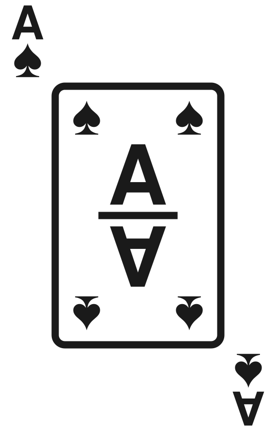
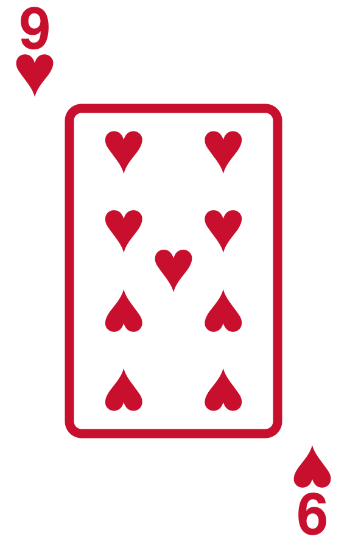
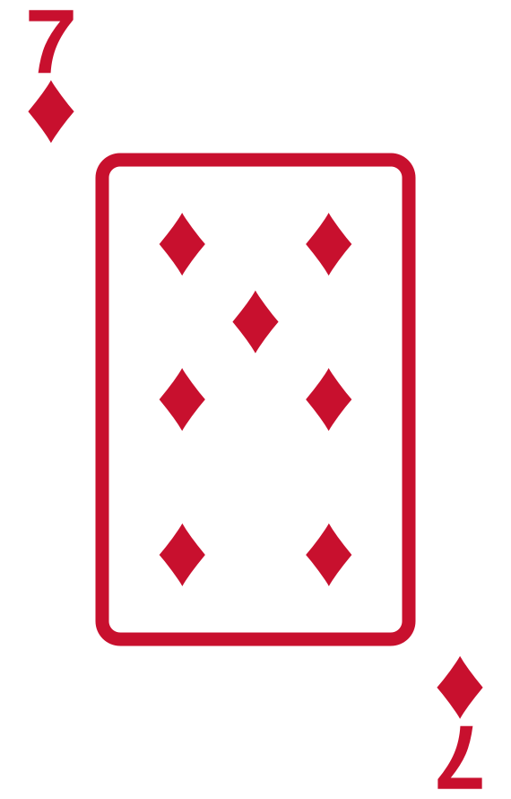
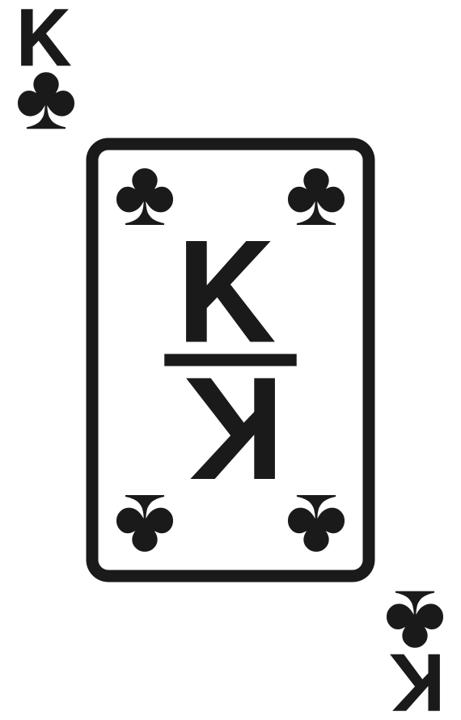
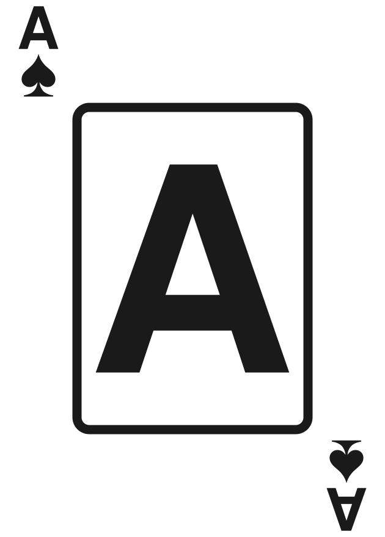
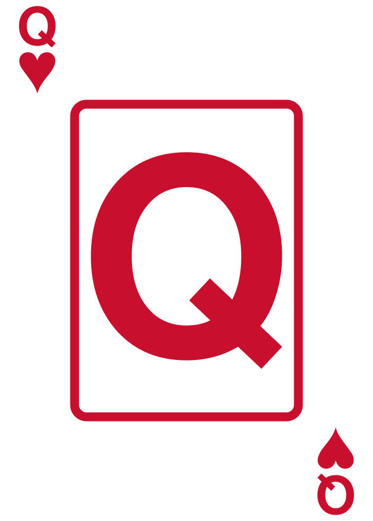
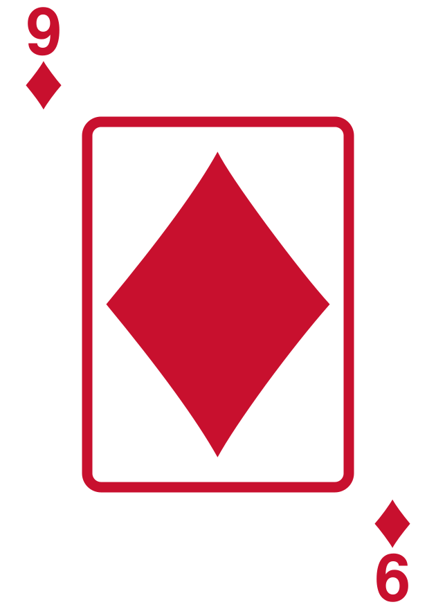
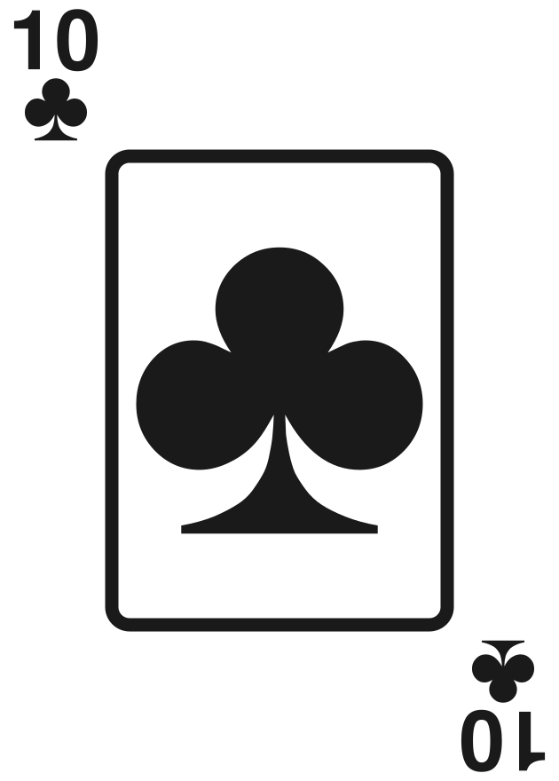

# cards-svg

Generates playing cards as standalone SVG documents. The output contains only
`<path>`, `<rect>` and `<use>` — no `<text>` and no font dependencies, so a card
renders identically in every tool.

## Examples

Bridge — 57 × 89 mm, `--layout traditional`:

|  |  |  |  |
| ----------------------------- | ----------------------------- | ------------------------------- | ---------------------------- |
| `spades A`                    | `hearts 9`                    | `diamonds 7`                    | `clubs K`                    |

Poker — 63 × 88 mm, `--layout jumbo`:

|  |  |  |  |
| ---------------------------- | ---------------------------- | ------------------------------ | ---------------------------- |
| `spades A`                   | `hearts Q`                   | `diamonds 9`                   | `clubs 10`                   |

## Usage

```bash
bun install

bun index.ts diamonds A                      # ace of diamonds on stdout
bun index.ts diamonds A --out diamond-A.svg  # save to a file
bun index.ts hearts 9                        # full pip pattern (default layout)
bun index.ts clubs A --layout jumbo          # one large mark in the middle
bun index.ts spades Q --font "Noto Sans"     # another glyph font
bun index.ts deck bridge                     # the whole deck into out/bridge/
bun index.ts deck poker                      # the whole deck into out/poker/
```

The ace of diamonds is the default, so a bare `bun index.ts` also gives A♦. Suit
names work in singular and plural (`diamond` / `diamonds`), and letter case does
not matter: `DIAMONDS a --style OUTLINED` is the same as
`diamonds A --style outlined`. A wrong value prints the allowed options and the
closest match.

### Flags

| Option                     | Default       | Description                                                               |
| -------------------------- | ------------- | ------------------------------------------------------------------------- |
| `<suit>`                   | `diamonds`    | `spades` \| `hearts` \| `diamonds` \| `clubs` (bridge order)              |
| `<rank>`                   | `A`           | `A` `K` `Q` `J` `10` `9` `8` `7` `6` `5` `4` `3` `2`                      |
| `--style`                  | `solid`       | `solid` (♦) or `outlined` (♢)                                             |
| `--layout`                 | `traditional` | `traditional` (rank pattern), `standard` (5 symbols) or `jumbo` (1 large) |
| `--deck`                   | —             | Card size, layout and font from a deck preset: `bridge` or `poker`        |
| `--font`                   | `FreeSans`    | Glyph font: `FreeSans` or `Noto Sans`                                     |
| `--color`                  | red/black     | Override the card color, e.g. `#C8102E`                                   |
| `--out`                    | stdout        | Path to write the SVG to                                                  |
| `--pretty` / `--no-pretty` | `--pretty`    | Multi-line formatting or a single line                                    |

### Deck

```bash
bun index.ts deck <bridge|poker> [--out-dir out] [--font <font>]
```

Writes all 52 cards as separate `<suit>-<rank>.svg` files in
`<out-dir>/<deck>/`.

| Preset   | Card size  | Middle column layout         | Directory     |
| -------- | ---------- | ---------------------------- | ------------- |
| `bridge` | 57 × 89 mm | `traditional` (rank pattern) | `out/bridge/` |
| `poker`  | 63 × 88 mm | `jumbo` (1 large symbol)     | `out/poker/`  |

## Library

```ts
import { renderCard } from "./src/index.ts";

const svg = renderCard({ suit: "diamonds", rank: "A" });
```

`renderCard()` takes a `CardSpec` (`suit`, `rank`, `style`, `layout`, `size`,
`color`, `font`, `pretty`) and returns a ready SVG document. `viewBox` units are
0.1 mm, so a 57 × 89 mm card has a viewBox of `0 0 570 890`.

- `cardGeometry({ widthMm: 63, heightMm: 88 })` — geometry for any card size.
- `renderDeck(DECKS.poker)` / `writeDeck(DECKS.poker, "out")` — a whole deck.
- `PIP_LAYOUTS[rank]` in `src/pips.ts` — pip positions normalized to the pip
  field (`fx`/`fy` from 0 to 1), so one pattern works for every card size.

## How it works

A card is built from three columns (20% / 60% / 20%): the index at the top, a
framed middle pattern, and the same index rotated at the bottom. The column and
frame layout is computed in percentages of the card, while the drawn elements
(glyphs, line weight, corner radii) have a fixed size in millimeters — which is
why the bridge and poker decks look like the same design, only in another format.

Every shape is declared exactly once in `<defs>` and referenced through `<use>`,
so the A♣ card is ~1.9 KB instead of ~3.7 KB, and positioning is the
`transform` alone.

**Ranks 2–10** draw as many symbols in the middle column as their value, following
the usual deck convention; the lower half of the pattern is rotated 180°.
**The ace and the face cards** have no pip count, so in `traditional` they get the
rank letter twice, above and below a horizontal rule (the lower letter rotated
180°), and in `jumbo` one large letter.

**One suit symbol is one size** across the whole card — in the index, in the
corners and in the middle pattern (`SUIT_HEIGHT_MM`, 7 mm). The four colors differ
in width, which is what tells them apart, but never in height.

**Rank sizes come from the cap height**, not from the glyph bounding box. The
letters `J` and `Q` drop below the baseline, so their bounding box is up to 30%
taller than the visible letter — `capHeight()` in `src/glyphs.ts` measures from
the baseline to the top of the capital, and that is what ranks are sized by. This
is what makes `A`, `K`, `Q` and `J` read as one type size.

## Glyph fonts

Glyphs are **vectorized ahead of time**, one set per font, so `--font` picks a
finished set instead of reaching for a system font at runtime. The card generator
itself needs neither Inkscape nor the network. `bun index.ts generate --help`
lists the available fonts.

A new font is added with the generator (requires `inkscape` and fontconfig, on the
development machine only), and its set is then added to `FONT_SETS` in
`src/glyphs.ts`:

```bash
bun run glyphs -- --font "Liberation Sans" --name "Liberation Sans" \
  --out src/fonts/liberation-sans.ts
```

`GlyphSet` is exhaustive (keyed by every `GlyphId`), so a missing suit symbol or
rank does not compile. No text font has every glyph needed — suit symbols
(U+2660–U+2667) usually are missing — so `--font` takes a **list of fontconfig
families** and resolves each glyph on its own: `Noto Sans, Noto Sans Symbols 2`.

## Development

```bash
bun test            # 175 tests: geometry, glyphs, pips, SVG, render, decks, CLI
bun run typecheck   # bun check
bun fmt             # formatting (bun fmt --check)
```

## Limitations

- The traditional pip pattern covers ranks 2–10; the ace and face cards show rank
  letters in the middle.
- No print margins or crop marks — a card is a clean outline.
